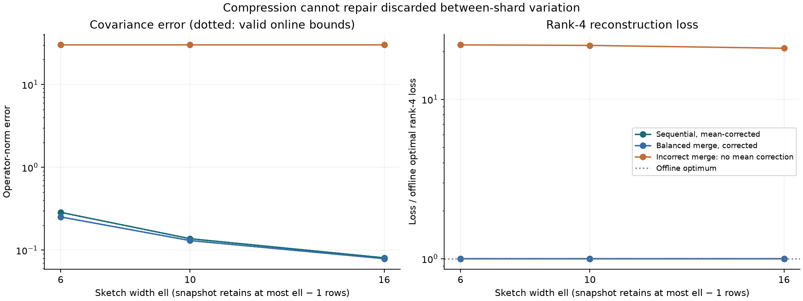
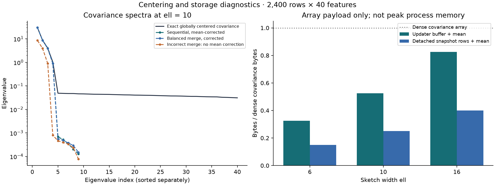

# Mergeable centered Frequent Directions

[](https://github.com/lcx0731/mergeable-centered-fd/actions/workflows/tests.yml)

An original educational implementation of the standard Frequent Directions
matrix-sketching algorithm with global centering and mean-corrected summary
merges. It tracks an accumulated covariance-error bound and tests it against
exact offline references. The synthetic experiment isolates the damage caused
by omitting between-shard mean variation.

**A small matrix can summarize a large stream, but only if it summarizes the
right covariance.** In this constructed example, corrected summaries recover
the leading subspace closely. Merging locally centered sketches without a mean
correction loses the strongest global variation, giving about 21 times the
optimal rank-4 reconstruction loss even as sketch capacity increases.



## Run

Python 3.11 or newer:

```bash
git clone https://github.com/lcx0731/mergeable-centered-fd.git
cd mergeable-centered-fd
python3 -m venv .venv
source .venv/bin/activate
python -m pip install '.[test]'
python -W error -m pytest -q
python -W error -m centered_fd.experiment --output results
```

The command generates a JSON summary and two PNG figures. The core maintains
bounded-size sketch buffers; the example intentionally materializes synthetic
data for an offline accuracy audit. No private or external data is used.

The installed command `centered-fd --output results` is equivalent. Defaults are
seed `20261012` and batch size 75; change them with `--seed` and `--batch-size`.
For the recorded Python 3.13 dependency snapshot:

```bash
python -m pip install -r requirements-repro.txt
python -m pip install --no-deps .
```

Reinstall after editing source. Same-environment repeated runs produce identical
JSON; floating-point last bits, SVD bases and PNG rendering may vary across
platforms or dependency versions. CI tests supported dependency ranges on
Python 3.11 and 3.13.

## The centering problem

For two disjoint groups with counts `n1,n2`, means `mu1,mu2`, and centered scatter
matrices `S1,S2`, pooling their observations gives

```text
n  = n1 + n2
mu = mu1 + (n2/n)*(mu2-mu1)
S  = S1 + S2 + (n1*n2/n)*(mu2-mu1)*(mu2-mu1)'.
```

The last term is **between-group scatter**. For example, two constant groups at
locations 0 and 2 each have zero within-group variance, but their pooled data do
not have zero variance. This case is checked explicitly in the tests.

A sketch `B` approximates scatter by `B'B`. Merging two sketches therefore feeds
their rows **and one correction row** into a new sketch:

```text
stack(B1, B2, sqrt(n1*n2/n) * (mu2-mu1)').
```

An update with a raw batch uses the same identity: feed batch-centered rows and
the correction relative to the previous running mean. The stored trace is
updated by adding the batch's centered squared norm and the correction row's
squared norm. No subtraction of two large raw second moments is needed.
An empty input is a no-op.

## Frequent Directions mechanics and bounds

The uncentered sketch buffers at most `2*ell` rows. At compression, compute a
thin SVD and set `delta = sigma_ell^2`. Keep singular values
`sqrt(max(sigma_i^2-delta,0))` for `i=1,...,ell-1`; remaining directions are
discarded. The ell-th row would be zero, so snapshots store at most `ell-1` rows.

Let `A` denote all observations centered around their **global** mean, and let
`Delta` be the accumulated shrinkage, including inherited shrinkage from merged
summaries. In exact arithmetic the standard FD invariants imply

```text
0 <= A'A - B'B <= Delta * I             (positive-semidefinite order)
ell * Delta <= ||A||_F^2 - ||B||_F^2
Delta <= ||A - A_k||_F^2 / (ell-k),     for 0 <= k < ell.
```

Consequently the operator-norm error of the sample covariance `B'B/(n-1)` is
bounded by `Delta/(n-1)`. The top-k right singular vectors of `B` also give the
standard reconstruction bound

```text
||A - A*V_k*V_k'||_F^2 <= (1 + k/(ell-k)) * ||A-A_k||_F^2.
```

`A_k` is the offline best rank-k approximation; it is only computed in the
audit, not needed by the streaming algorithm. The online bound uses accumulated
shrinkage, while the tail-energy bound needs this offline reference. Mean
correction preserves the exact centered Gram identity, so the same invariants
apply to the transformed rows and to corrected merges. The finite-precision
checks allow scale-aware rounding tolerance; they are not interval-arithmetic
certificates.

Snapshots are detached, read-only arrays; querying them does not change future
updates. `merged()` returns a new object without changing either input. Merge
trees and batch partitions can change the approximation, although the moment
identities and error guarantees remain. **Merging is not deduplication:** inputs
must represent disjoint observations unless double-counting is intended.

## Synthetic experiment

The dataset has eight shards, each with 300 observations and 40 features. A
seeded orthogonal rotation defines the directions. Shard means have levels
`[-8,-6,-4,-2,2,4,6,8]` along the first direction. Within-shard Gaussian factors
use the next three directions with standard deviations `[3,2,1]`, plus isotropic
Gaussian noise of standard deviation 0.2. No data are downloaded.

We compare widths `ell in {6,10,16}` and project to rank 4:

- **Sequential corrected:** ingest shards in order, in batches of 75, with global
  running-mean corrections.
- **Balanced merge corrected:** create eight independent centered summaries,
  then combine pairs in a balanced tree using the correction row.
- **Omit mean correction:** an intentionally incorrect baseline isolated in
  `experiment.py`. It stacks local sketch rows without between-shard corrections.
  Its shrinkage bound describes **within-shard scatter only**, not the target
  global covariance. The global-bound field is explicitly `null` for this method.

All methods' projection losses are evaluated on the same globally centered
matrix, so the incorrect baseline is penalized for its missing covariance
direction, not for using an incorrect evaluation mean. This is a fixed synthetic
stress example, not a repeated-sampling or out-of-sample prediction study.

### Observed results

Covariance operator-norm errors use `ddof=1`. Reconstruction ratios compare with
the exact offline optimal rank-4 squared Frobenius loss; 1 is optimal.

| ell | Method | Covariance error | Valid online bound | Reconstruction ratio |
|---:|---|---:|---:|---:|
| 6 | Sequential corrected | 0.286002 | 0.286088 | 1.000027 |
| 6 | Balanced merge corrected | 0.251716 | 0.252147 | 1.000020 |
| 6 | Omit mean correction | 30.076686 | Not applicable | 21.958354 |
| 10 | Sequential corrected | 0.137483 | 0.137514 | 1.000004 |
| 10 | Balanced merge corrected | 0.130526 | 0.130675 | 1.000004 |
| 10 | Omit mean correction | 30.076635 | Not applicable | 21.783185 |
| 16 | Sequential corrected | 0.080811 | 0.080820 | 1.000001 |
| 16 | Balanced merge corrected | 0.078904 | 0.078955 | 1.000001 |
| 16 | Omit mean correction | 30.076516 | Not applicable | 20.906751 |

The covariance norm of the omitted between-shard term alone is **30.038907**.
The pooled-scatter identity has relative Frobenius residual **1.18e-15** in this
run. At ell=10, the incorrect baseline's bound for its *different, within-only*
target is about 0.129973. Reporting that as a global error bound would be false.
The two valid methods have different answers; balanced merging is not asserted
to dominate sequential processing on other data or metrics.



The spectrum plot sorts each matrix's eigenvalues independently; matching indices
do not assert matching eigenvectors. Only positive retained sketch eigenvalues
are plotted on the log scale. Very small tail eigenvalues are strongly shrunk,
even when the leading reconstruction subspace is accurate. A sketch is therefore
not a drop-in full-rank covariance inverse.

### Storage accounting, not a peak-memory benchmark

| ell | One updater's buffer + mean | Snapshot rows + mean | Dense covariance |
|---:|---:|---:|---:|
| 6 | 4,160 bytes | 1,920 bytes | 12,800 bytes |
| 10 | 6,720 bytes | 3,200 bytes | 12,800 bytes |
| 16 | 10,560 bytes | 5,120 bytes | 12,800 bytes |

These count float64 array payloads only. One updater stores `(2*ell*d+d)` floats,
plus scalar metadata; a full snapshot uses at most `ell*d` floats including its
mean. The full 2,400 by 40 audit matrix is 768,000 bytes. Input batches, temporary
centering arrays, SVD workspaces, Python objects, copies and multiple live worker
summaries are **not** included in these figures. The example deliberately holds
all synthetic rows and reference covariance matrices in memory for validation.
No end-to-end process memory or runtime advantage is claimed. For large ell,
the live buffer can exceed a dense covariance's storage.

## Small API example

```python
import numpy as np
from centered_fd import CenteredFD

rng = np.random.default_rng(5)
first = CenteredFD(dimension=20, ell=8)
second = CenteredFD(dimension=20, ell=8)
first.update(rng.normal(size=(100, 20)))
second.update(rng.normal(size=(100, 20)) + 3)
state = first.merged(second).snapshot()

print(state.count, state.mean)
print(state.covariance_error_bound(ddof=1))
components = state.components(k=4)  # Four orthonormal row vectors.
# Optional small-problem diagnostic; explicitly materializes a d-by-d matrix:
approximate_covariance = state.covariance(ddof=1)
```

## Tests and layout

The 43 test cases cover a hand-calculated shrink step, spectral/PSD/trace and
tail-energy bounds at streaming prefixes, exact moment identities, rank-deficient
and constant data, pure between-group variation, different merge trees,
non-mutating snapshots and merges, translation invariance, reconstruction bounds,
sample-size and input guards, and end-to-end generated artifacts. The full
example also checks all applicable bounds before writing output.

```text
src/centered_fd/core.py        Bounded FD buffers, centered updates, immutable snapshots
src/centered_fd/experiment.py  Synthetic shards, merge audit, isolated wrong baseline, plots
tests/                        Mathematical and integration checks
results/                      Actual generated JSON and two figures
```

The project demonstrates streaming numerical algorithms, mergeable data
summaries, explicit target definitions, and reproducible error checking.

## Scope

Deterministic, dense, float64 sketches for complete numeric rows. Not a new PCA
algorithm, a production distributed execution system, or an empirical performance
claim. Different merge trees may produce different sketches. Mathematical bounds
are exact-arithmetic statements, checked with scale-aware floating-point
tolerances here.

Further limits: no missing-value handling, standardization, weighted samples,
deletions, sliding windows, privacy guarantee, checkpoint/restore format, worker
orchestration, or performance tuning. Features must already have appropriate
scales for the intended PCA objective. This intentionally separated spectrum is
favorable to leading-subspace recovery; flatter spectra may need larger sketches.
The covariance denominator must satisfy `0 <= ddof < count`. Components require
enough stored rows. Extreme dynamic ranges and formally rounded error bounds are
outside scope. Nothing is copied from private research or application materials.

## Reference

Ghashami, Liberty, Phillips and Woodruff, [Frequent Directions: Simple and
Deterministic Matrix Sketching](https://arxiv.org/abs/1501.01711), SIAM Journal
on Computing (2016). The algorithm and guarantees are standard; code and
synthetic experiment in this repository are newly written, not copied from
reference implementations.

Pébay (2008), [Formulas for Robust, One-Pass Parallel Computation of Covariances
and Arbitrary-Order Statistical Moments](https://www.sandia.gov/research/publications/details/formulas-for-robust-one-pass-parallel-computation-of-covariances-and-arbitr-2008-09-01/),
SAND2008-6212, provides background on pairwise centered-moment updates.
NumPy's [SVD documentation](https://numpy.org/doc/stable/reference/generated/numpy.linalg.svd.html)
describes the numerical primitive used here.

Code is licensed under [MIT](LICENSE).
